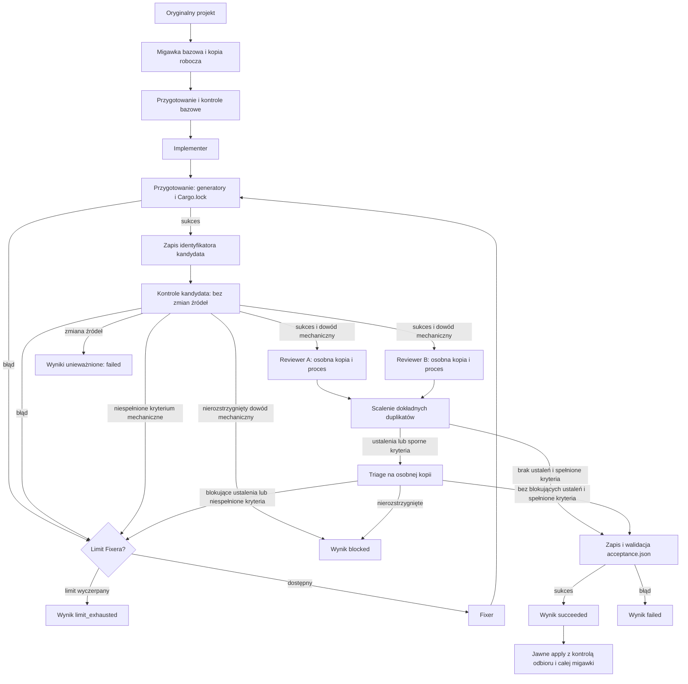

# Architektura workflow

`bb-rust-workflow` to lokalna maszyna stanów. Python steruje kolejnością etapów, procesami CLI, walidacją odpowiedzi, migawkami i zastosowaniem zmian. Agent nie może własną deklaracją pominąć kontroli ani zakończyć pętli. Celem jest audytowalny przebieg dla projektu Rust przy skończonych limitach czasu i wywołań.

## Przebieg

Recenzje są **niezależne co do procesu i kopii**: obaj recenzenci widzą tę samą zamrożoną migawkę, wymagania, wyniki kontroli i diff, ale nie wyniki drugiego recenzenta. Wywołania są sekwencyjne, co utrzymuje przewidywalny budżet. Po recenzjach program porównuje manifest źródła z migawką; zmiana w trakcie przeglądu kończy przebieg błędem. Triage musi rozstrzygnąć każde ustalenie dokładnie raz jako `confirmed`, `rejected`, `duplicate` lub `unresolved`, z uzasadnieniem. Dokładne duplikaty są scalane z zachowaniem pochodzenia; inne pozornie podobne uwagi rozstrzyga triage. Poziom kanonicznego ustalenia zachowuje najwyższą wagę w grupie duplikatów, aby scalanie nie usunęło blokady. Potwierdzone ustalenie zawiera też `duplicates` z pełnymi dowodami i pochodzeniem pozostałych uwag w grupie; Fixer otrzymuje je razem, aby naprawa nie zgubiła odmiennego scenariusza błędu. Ustalenia dotyczące usuniętych plików mogą wskazywać ścieżkę i linię z migawki bazowej. Kontekst Fixera wskazuje również `baseline_directory`, co pozwala odtworzyć dowody z usuniętych źródeł. `unresolved` blokuje sukces. Potwierdzone ustalenia o poziomach wymienionych w `blocking_severities` kierują do Fixera; domyślnie blokują `critical`, `high`, `medium`.

`max_cycles` oznacza liczbę **wywołań Fixera**, nie liczbę przeglądów. Brak zmian po naprawie albo powrót do wcześniej widzianej migawki kończy się `no_progress`. Po każdej naprawie wszystkie kontrole i obie recenzje są wykonywane ponownie. Każde wywołanie agenta liczy się do `max_agent_calls`; każdy proces ma własny timeout, a przed etapami sprawdzany jest budżet `max_seconds`. To limit kooperatywny: lokalne kopiowanie/hashowanie i sprzątanie procesów mogą opóźnić zakończenie poza budżet; operacje dyskowe nie są przerywane w połowie. Ponowienia dotyczą tylko ról odczytowych. Informacja o koszcie może być częściowa: raport przechowuje kwoty podane przez backend i liczbę wywołań bez kwoty, bez szacowania nieznanej sumy USD.

Polecenia `prepare` mogą zmieniać źródła i pliki wygenerowane; ich błędy kandydata kierują do ograniczonej pętli Fixera. Po przygotowaniu program zapisuje manifest kandydata. Przed i po każdej kontroli porównuje pliki z tym manifestem, a wyniki przechowują `snapshot_id`, `result_snapshot_id` i `source_unchanged`. Zmiana podczas kontroli kończy się `failed`, bez próby uznania wcześniejszych wyników za aktualne. Dopiero niezmieniony, sprawdzony kandydat trafia do recenzji.

Każda kopia — także bazowa, recenzenta i triage — ma własne `.git` i lokalny commit przechwyconej zawartości. Git nie wyszukuje repozytorium nadrzędnego. Kopia robocza zachowuje jako bazę aktualne źródła użytkownika, również zmiany niezatwierdzone i pliki nieśledzone. Kopie recenzentów zapisują jako własny commit otrzymanego kandydata; różnicę względem oryginału otrzymują w kontekście przeglądu i katalogu `baseline`. Inicjalizacja nie używa globalnych hooków, szablonów ani podpisywania. Procesy otrzymują środowisko bez zmiennych przekierowujących Git do innego repozytorium.

Przed kontrolami i pierwszym wywołaniem dostawcy program sprawdza istnienie zasobów wszystkich wybranych ról: umiejętności wewnątrz kopii projektu i plików MCP. Obejmuje to również warunkowe role triage/Fixer. Kontrola powtarza się przy wywołaniu roli, ponieważ wcześniejszy etap mógł usunąć wymagany plik. Nie sprawdza uwierzytelnienia ani dostępności modelu na koncie.

`BackendError.retryable` rozróżnia błędy dopuszczające ograniczone ponowienie od błędów konfiguracji adaptera, uruchomienia procesu, zmiany modelu i przekroczenia limitu wyjścia. Te ostatnie zatrzymują rolę bez ponowień. Pozostałe błędy dostawcy mogą być ponawiane tylko dla odczytowych ról, po ponownym sprawdzeniu niezmienności kopii i w ramach istniejących limitów.

## Kryteria odbioru (etap 4)

`Workflow(..., *, requirements: Requirements | None = None)` kopiuje konfigurację i jednorazowo
rozwiązuje niezmienny pełny gate. V3 bez kryteriów blokuje `run` przed kontrolami i dostawcami;
v1/v2 bez kryteriów i bez włączonego `rust_review` mają jawny tryb `legacy` i schemat odpowiedzi v1.
Podane kryteria w każdej wersji konfiguracji włączają schemat v2. Niepoprawne nowe wejście nigdy
nie uruchamia fallbacku.
`plan` bez kryteriów, `doctor` i samodzielne `verify` nadal są dostępne.

Przed implementacją zapisuje się wymagania i plan. Powiązanie każdej odpowiedzi obejmuje
`candidate_id`, `requirements_id`, `verification_plan_id`. Dla roli zapisującej kandydat oznacza
migawkę przed wywołaniem; `criterion_evidence` są propozycjami, bez prawa zatwierdzenia. Recenzenci
otrzymują powiązanie rzeczywistego przygotowanego i sprawdzonego kandydata oraz identyczne kryteria
i dowody mechaniczne. Nie otrzymują wzajemnych ocen. Każdy ocenia wszystkie kryteria semantyczne.

Po pełnym gate program zapisuje `acceptance.rounds[].mechanical`. Brak testu lub zero wykonanych
przypadków kieruje do ograniczonego Fixera; nieznany wynik blokuje. Każde kryterium bezpośredniego
`cargo test` wymaga dodatniej liczby zaliczonych testów w zakończonym udanym wyniku libtest,
a nazwane wymaga dokładnej zaliczonej nazwy. Nazwane kryteria `cargo miri test` podlegają
tej samej kontroli; historyczne Miri bez `test_name` zachowuje dowód poprawnego zakończenia
komendy. Sprawdzane są pełne logi, oba identyfikatory źródeł,
komenda, profil, wariant i brak błędów/limitów. Kryterium własnej nietestowej komendy ufa jej
poprawnemu zakończeniu. Fatalna zmiana źródeł, przerwanie lub budżet zachowuje swój status;
dostępny częściowy dowód jest audytowany bez kierowania do semantycznego override.

Obustronne `satisfied` rozstrzyga kryterium semantyczne. Każde inne zestawienie trafia do triage,
nawet przy pustych `findings`; `criterion_decisions` rozstrzyga dokładnie sporne ID, oddzielnie od
oryginalnych `decisions` ustaleń kodowych. `unresolved` blokuje; `unmet` wymaga naprawy niezależnie
od wagi ustaleń. Cały gate i obie recenzje powtarzają się po każdej naprawie. Status odpowiedzi
`completed` oznacza wykonanie przydzielonego review/triage i może zawierać niespełnione kryteria.
Sukces wymaga aktualnego dowodu dla każdego kryterium oraz wszystkich poprzednich gwarancji.

`acceptance` w stanie zawiera tryb, hashe i pełne rundy. `status --summary` pomija pełne rundy.

## Adapter Rust PR review

Opcjonalne `[rust_review]` ma `enabled = false` i wersję polityki `1`. Przy włączeniu wymaga
niepustych kryteriów zadania w każdej wersji konfiguracji. `required` deklaruje rodzaje
`memory`, `deadlocks`, `cancellation`, `task_lifecycle`, `loom`; każdy musi mieć wpis
`evidence` z `kind`, `check_id` i dokładnym `test_name`. Walidacja odrzuca brakujące,
powtórzone i nieznane deklaracje. Polecenia nadal pochodzą wyłącznie z pełnego gate;
adapter nie dopisuje ani nie zmienia komend podczas przebiegu.

`rust_review.py` dopisuje przed zamrożeniem zwykłe kryteria semantyczne `rust-review-spec`,
`rust-review-scope`, `rust-review-memory`, `rust-review-async`, `rust-review-sync` oraz
mechaniczne `rust-review-test-<indeks>` dla zadeklarowanych testów. Prefiks jest zarezerwowany.
Kryterium zakresu utrwala kanoniczną politykę, wersję adaptera i przypięte źródło metody.
Tekst kryteriów wersji 1 pozostaje częścią trwałej tożsamości wymagań. Schemat wymagań v1
i odpowiedzi v2 pozostają wspólne; wyłączona polityka nie zmienia wymagań ani ich skrótu.

Dowód `memory` musi wskazywać bezpośrednie `cargo [+toolchain] miri test`; pozostałe rodzaje
wskazują bezpośrednie testy Cargo. Wszystkie wymagają dokładnej zaliczonej nazwy w zakończonym,
niepustym wyniku libtest oraz aktualnego powiązania kandydata i pełnych logów. Wrappery,
nextest, samo przygotowanie Miri i sam kod wyjścia zero nie zastępują tego dowodu. Testy
Miri używają jawnych argumentów i domyślnego wariantu; istniejący mechanizm macierzy nie
przekształca takich niestandardowych komend.

`prompts/rust_pr_review.md` jest dołączany do obu recenzentów i triage; każdy recenzent
wykonuje przegląd poprawności oraz osobny przegląd specyfikacji, zachowując swój dotychczasowy
zakres uwagi. Nie powstaje nowa rola ani etap. Obie recenzje widzą tę samą politykę i kryteria,
bez wzajemnych odpowiedzi. Adapter nie uruchamia upstreamowych skryptów, hooków, agentów ani
instalacji. Projektowe skills nadal dostarczają wybraną wiedzę; cała baza reguł nie jest
pobierana automatycznie. Brak LSP/MCP wymaga ujawnienia ograniczenia, nie zgłoszenia usterki.

Mechanicznego braku dowodu nie można rozstrzygnąć semantycznie. Ponadto `preserve_safety_gaps`
zachowuje `unresolved` dowolnego recenzenta dla kryteriów `scope`, `memory`, `async` i `sync`,
nawet gdy triage zwróci `satisfied`; końcowy wynik pozostaje zablokowany. Specyfikacja nadal
podlega zwykłemu triage. Recenzenci oceniają niezależny argument aliasowania/FFI, adekwatność
testów async oraz odwzorowanie, asercje, granice i zakończenie modelu Loom. Log zaliczonego
testu nie rozstrzyga prawdziwości tych argumentów. Nowy obowiązek poza zamrożonym planem
wymaga odpowiedzi `blocked` i nowego przebiegu z uzupełnioną polityką.

Źródło metody: [rust-pr-review, rewizja 268582b5](https://github.com/rtmachines/rtm-coding/tree/268582b5c4d8f91bc709294b9ebbe270a181f9b2/skills/rust-pr-review).
Przykład użytkowy: [konfiguracja Miri, async i Loom](../examples/rust-review/README.md).

## Końcowy odbiór i raport (etap 5)

Przed nadaniem `succeeded` silnik buduje i zapisuje `acceptance.json`, po czym sprawdza go
wobec trwałych dowodów. Błąd zapisu lub walidacji nie pozostawia sukcesu uprawniającego do apply.
Raport wersji 1 zawiera `version`, `mode`, `cycle`, `binding`, `gate`, `criteria`, `review`
i `provenance`. Powiązanie identyfikuje finalnego kandydata, zamrożone wymagania i cały plan.
`gate` zachowuje `profile`, `variants`, `package`, `test_filter`, `planned_checks`, `results`;
końcowy gate nie dopuszcza zawężenia pakietu ani filtra. `criteria` zawiera opis, werdykt i dowód
każdego kryterium; `review` obejmuje obie niezależne recenzje i ewentualny triage, a `provenance`
wiąże je z ukończonymi wywołaniami i zapisanymi zwalidowanymi odpowiedziami.

`state.json` ma wersję 2 i `report_contract = 1`. Jego `acceptance_report` zawiera `version`,
`file` (dokładnie `acceptance.json`), kanoniczny SHA-256 `digest` i `binding`. Wersje konfiguracji
1/2/3 i schematów odpowiedzi 1/2 są od tego niezależne. Nowy tryb `legacy` również zapisuje
i wymaga końcowego raportu, z pustymi kryteriami i jawnym brakiem gwarancji wymagań.

`acceptance.py` odtwarza kontrakt z zapisanych wymagań, planu, kontroli i recenzji, ponownie
ocenia mechaniczne dowody z pełnych logów i porównuje wynik z raportem oraz metadanymi stanu.
Sprawdza kompletność i kolejność gate, niezmienność źródeł, powiązania, aktualne werdykty,
protokół odpowiedzi i odrębne pochodzenie recenzji. `apply` wykonuje tę kontrolę lokalnie pod
istniejącą blokadą, przed backupem; nie wywołuje modeli ani Cargo. Następnie obowiązują wszystkie
dotychczasowe kontrole manifestów i odzyskiwanie po błędach.

Przy aktywnym adapterze raport zawiera także `rust_review`. Odtworzenie odbioru sprawdza
zapisaną politykę, dokładną treść i kolejność dopisanych kryteriów oraz ich zgodność z planem.
Ponownie stosuje zachowanie nierozstrzygniętych kryteriów bezpieczeństwa i ocenia nazwane testy
z pełnych logów. Usunięta polityka, zmienione kryteria lub brak dowodu nie uprawniają do `apply`.
Historyczne raporty bez polityki zachowują dotychczasowy kontrakt.

Historyczne stany bez wersji lub z wersją 1 zachowują dawny kontrakt tylko bez oznak nowego
formatu. Znacznik, metadane raportu, sam raport lub nowe pochodzenie odpowiedzi/recenzji
uniemożliwiają taki fallback po obniżeniu wersji. Nieznane wersje i niekompletne nowe raporty
są odrzucane. Skróty i odtworzenie chronią przed przypadkową nieaktualnością lub niespójnością;
nie stanowią podpisu ani ochrony przed skoordynowaną zmianą wszystkich lokalnych dowodów.

`reporting.py` tworzy czytelny `report.md`: zakres planu i wykonane warianty, klasyfikację
diagnostyki, kryteria z dowodami i powiązaniami, recenzje, triage i pomiary. Rundy historyczne
i częściowe są odróżnione od zatwierdzonej końcowej rundy. Niepełny przebieg nie publikuje
końcowego zatwierdzenia. Sukces poświadcza skonfigurowany zakres, nie kompletność wymagań.

## Odpowiedzialności modułów

| Moduł | Odpowiedzialność |
| --- | --- |
| `cli.py` | Polecenia `init`, `plan`, `doctor`, `verify`, `run`, `status`, `apply`; wejście konsolowe i raportowanie wyników. |
| `config.py`, `default.toml` | Parsowanie TOML, walidacja limitów/modeli/narzędzi i profili weryfikacji, heurystyka złożoności oraz wybór pięciu ról. |
| `engine.py` | Orkiestracja maszyny stanów: migawka, implementacja, kontrole, recenzje, triage, Fixer, limity, artefakty i raport. Pełny gate nadal poprzedza recenzje każdego kandydata. |
| `verification.py`, `verification_metadata.py` | Planowanie profili i wariantów, wykonanie kontroli, ograniczone próby wersji, skróty konfiguracji i raporty samodzielnego `verify`. |
| `diagnostics.py` | Czyste parsowanie pełnych strumieni, zachowawcze porównanie diagnostyki i skróty dowodów; bez uprawnień do zmiany wyniku wykonania. |
| `backends.py` | Jedna świeża sesja CLI dla roli, jawny model i format strukturalny, zapis surowego wyjścia, sprawdzenie zakończenia i zgłoszonego modelu. |
| `usage.py` | Normalizacja liczników Claude/Codex, cache bez podwójnego liczenia, sumy zmierzonych tokenów i jawne braki danych. |
| `lifecycle.py` | Doradcza telemetria bieżącej operacji i heartbeat, walidacja widoku postępu oraz ograniczona do CLI obsługa SIGTERM. |
| `process.py` | Uruchomienie argv bez powłoki, przechwycenie stdout/stderr, timeout i próba zatrzymania drzewa procesów na Linux/macOS/Windows. |
| `_windows_job.py` | Nadzorca Windows: przed uruchomieniem polecenia dołącza do Job Object z kończeniem członków przy zamknięciu; przekazuje kod zakończenia i błędy przez prywatny plik wyniku. |
| `requirements.py` | Ścisły niezmienny kontrakt wymagań, hashe pełnego planu i ocena mechanicznego dowodu z audytowanych kontroli i pełnych logów. |
| `rust_review.py` | Wersjonowana polityka Rust review, kanoniczne kryteria adaptera, kontrola ich odtworzenia i zachowanie nierozstrzygniętych dowodów bezpieczeństwa. |
| `acceptance.py`, `reporting.py` | Budowa i lokalna walidacja końcowego kontraktu odbioru; czytelny raport pełnych, historycznych i częściowych dowodów. |
| `protocol.py` | Wspólny schemat JSON odpowiedzi, walidacja ścieżek/linii ustaleń, deduplikacja oraz pełne rozstrzygnięcie triage. |
| `workspace.py` | Manifesty hashujące treść i prawa plików, zweryfikowane kopie, blokada projektu oraz `apply` z kontrolą konfliktu i próbą wycofania. |
| `prompts/*.md` | Instrukcje poszczególnych ról; nie są mechanizmem egzekwowania limitów ani kolejności. |

Samodzielne `verify` korzysta ze wspólnego wykonawcy kontroli, ale działa bezpośrednio na wskazanym repozytorium, pod jego blokadą. Nie wykonuje `prepare`, nie tworzy migawek ani workspace kandydata i nie wywołuje agentów. Zamraża manifest źródeł, porównuje go przed i po poleceniach oraz zapisuje pełne logi i raporty `report.json`/`report.md` w `.bb-workflow/verifications/<id>/`. Zmiany źródeł są wykrywane i powodują unieważnienie wyników; nie są automatycznie cofane. Nawet status `passed` ma `apply_eligible = false` i nie może autoryzować `apply`.

Claude dostaje minimalny zestaw narzędzi odpowiedni dla roli; zapis ma tylko implementer i Fixer. Opcjonalny `LSP` i `mcp_config` dotyczą Claude. Codex używa odczytowego lub zapisywalnego trybu pracy odpowiednio do roli, pomija odziedziczoną konfigurację użytkownika i w tym MVP nie przyjmuje konfiguracji MCP. Kontrole Rust (`cargo`) uruchamia sam orkiestrator z konfiguracji, a nie agent. Dostępność LSP nie jest warunkiem przebiegu: agent ma ujawnić fallback do źródeł, testów i `cargo`.

## Stan i artefakty

Jeden `run` tworzy `.bb-workflow/runs/<id>/` wewnątrz oryginalnego projektu:

- `workspace/`: kandydat edytowany przez implementera i Fixera;
- `baseline/`, `baseline_manifest.json`: kopia i manifest stanu początkowego;
- `checks/`: komendy, stdout i stderr każdej kontroli;
- `requirements.json`, `verification_plan.json`: znormalizowane wejścia zamrożone przed implementacją;
- `round-*-reviewer_a/`, `round-*-reviewer_b/`, `round-*-triage/`: odczytowe kopie danej rundy;
- `agents/`: prompty, wywołania, schematy, odpowiedzi oraz surowe logi agentów;
- `state.json`: bieżący stan, routing, limity, przebieg kontroli, recenzje, triage i koszty;
- `candidate_manifest.json`: manifest wyniku `succeeded`;
- `acceptance.json`: końcowy kontrakt odbioru udanego przebiegu;
- `report.md`: czytelny raport dowodów, także po błędzie lub przerwaniu;
- `apply-backup/` i `apply.json`: kopie i wynik jawnego zastosowania, jeśli je rozpoczęto.

Każda kontrola walidacyjna ma `diagnostics.json` z pełnym wynikiem parsera i porównaniem oraz `metadata.json` z hashami konfiguracji/środowiska i odsyłaczami do prób wersji. Próby w `checks/<faza>/metadata/` używają tego samego wykonawcy, środowiska migawki, limitu wyjścia i wspólnego budżetu czasu. Źródła są sprawdzane po każdej próbie; zmiana unieważnia kontrolę. Niepewne lub nieudane próby nie dają znanej tożsamości narzędzia. Wszystkie polecenia `cargo test` przechwytują i wymagają wersji rustdoc, także bez `--doc`; jawny `RUSTDOC` wskazuje próbowany program. Cache nie przekracza granicy fazy. Konfiguracja obejmuje manifesty/lockfile, toolchain i Cargo/Clippy projektu, przodków, `CARGO_HOME`, `CLIPPY_CONF_DIR` oraz hashowane istotne zmienne środowiska. Niejednoznacznych nadpisań kompilatora, wrapperów, dołączanych konfiguracji i `--config` nie rozstrzygamy uniwersalnym resolverem: wersja pozostaje nieznana. Przechwycenie manifestów uwzględnia oba zapisy `--manifest-path`; wybrany manifest poza inwentarzem, zewnętrzne odwołania zależności/workspace, nieprzechwycony workspace/lockfile przodka i nierozstrzygnięte wzorce pozostawiają skrót nieznany. Kompletne lokalne workspace nadal porównują znane inwentarze. Własne reguły `exclude` nadal ograniczają odczyt; skrót konfiguracji jest wtedy nieznany, gdyż wykluczenia mogą ukrywać istotne pliki. Własne nierozpoznane polecenia pomijają przechwytywanie konfiguracji i próby wersji.

Parser odrzuca niekompletną tożsamość celu Cargo jako niepewną i ogranicza każdą konwersję liczb tekstowych przed utworzeniem integera. Nadmiernie długie/niepoprawne liczby nie przerywają zapisania rzeczywistego wyniku kontroli.

Pełne porównanie fazy trafia do `checks/<faza>/diagnostics.json`, a stan i prompty zawierają ograniczony skrót z odsyłaczem. Rekordy bazowe i ich pliki pozostają niezmienione; wszystkie rundy kandydata porównują się z oryginalnym baseline. Agregacja działa także w kończeniu po błędzie, obejmując `unobserved_previous` dla niewykonanych kontroli. `persistent` nie zwalnia z zaliczenia gate. Nieznana konfiguracja/wersja/zakres uniemożliwia porównanie, a brak pełnego udanego wykonania uniemożliwia `resolved`. Wcześniejszy błąd testowy wymaga jawnego przejścia tego samego testu w kompletnym jednoznacznym zestawie. Samodzielny `verify` zachowuje te same artefakty i ograniczenia, lecz bez automatycznej bazy klasyfikuje znalezione problemy jako `unclassified`.

`state.json` jest zapisywany atomowo po ważnych etapach. `phase` opisuje bieżącą czynność, a `status` wynik całego przebiegu. Stany końcowe obejmują `succeeded`, `blocked`, `limit_exhausted`, `budget_exhausted`, `no_progress`, `failed` i `interrupted`. Po skutecznym `apply` stan przyjmuje `applied`. Katalog przerwanego lub nieudanego przebiegu pozostaje do inspekcji; automatycznego `resume` nie ma.

Przerwanie procesu przekazuje przechwycone stdout/stderr wraz z wyjątkiem zgodnym z `KeyboardInterrupt`, po zatrzymaniu procesu i zamknięciu potoków. Adapter dostawcy oraz wspólny wykonawca poleceń w `verification.py` zapisują te logi przed ponownym zgłoszeniem przerwania. Dotyczy to zarówno `run`, jak i samodzielnego `verify`. Przerwane polecenie nie uruchamia ponownego skanowania potencjalnie niekompletnych źródeł; jego `result_snapshot_id` i `source_unchanged` pozostają nieznane (`null`). `verification_metadata.py` zachowuje wyjście przerwanych prób wersji w ich własnych artefaktach, bez przypisywania go niewykonanej kontroli i bez uznawania wersji za potwierdzoną. Przerwanie ma pierwszeństwo także przy osiągniętym limicie wyjścia; ograniczony zapisany prefiks nadal zachowuje znacznik przekroczenia limitu. `invocation.json` dostawcy otrzymuje status `interrupted` i pomiary możliwe do odzyskania z wyjścia; przerwanie nie staje się sukcesem ani powodem do ponowienia.

Kontekst agentów jest osobnym, skróconym widokiem dowodów: udane kontrole bez logów, błędy z ograniczonymi końcówkami i ścieżkami pełnych logów, diff z jawnym oznaczeniem pominięcia. Widok nie modyfikuje rekordów audytu. Limity `[context]` dotyczą fragmentów tekstu, nie całego kontekstu CLI ani budżetu tokenów. Schemat odpowiedzi trafia do natywnych flag CLI; `validate_response` nadal sprawdza wynik. Wybrane umiejętności są domyślnie wymaganymi odczytami plików, opcjonalnie wklejanymi przez `skill_mode = "inline"`.

`agents[].prompt_chars` i `prompt_bytes` opisują wysłany tekst, `usage` zachowuje dane dostawcy, a `token_usage` daje liczby znormalizowane. Dla Claude wejście obejmuje sumę niebuforowanego wejścia, odczytu cache i zapisu cache; dla Codex `input_tokens` już zawiera cache. `token_usage.by_backend` pokazuje zmierzone sumy wraz z `missing_calls` dla każdego licznika. Nieznanych wywołań nie uznaje się za darmowe. `status --summary` pomija szczegółowe dowody, pozostawiając postęp, pomiary i odsyłacz do raportu.

Poprawne pomiary zawarte w nieudanej odpowiedzi dostawcy są zachowywane w `invocation.json` i rekordzie agenta. Koszty są podsumowywane na podstawie rekordów przy każdym zapisie stanu; wywołanie przerwane lub zakończone wyjątkiem bez kwoty pozostaje nieznane. Odzyskane pomiary opisują raportowaną część użycia i nie gwarantują pełnego rozliczenia sesji zakończonej błędem.

## Obserwacja i kontrolowane przerwanie przebiegu

Po pierwszym trwałym zapisie stanu `run` ogłasza katalog przebiegu na stderr, przed
kopiowaniem projektu i kosztownymi wywołaniami. Domyślnie kolejne fazy nadal są tekstem,
a końcowy wynik JSON pozostaje na stdout. Opcjonalne `run --events-jsonl` zastępuje tekst
na stderr zdarzeniami JSONL: `version = 1`, `run_dir`, `event` (`start`, `phase`, `finish`)
i `phase`. Zdarzenia faz zawierają `active_operation`, a końcowe także `status`.

`lifecycle.py` prowadzi niezależny, atomowo zastępowany `progress.json`: `version = 1`,
`run_dir`, `pid`, `phase`, `active_operation`, `updated_at`, `elapsed_seconds` oraz
`heartbeat_interval_seconds = 5`. Bieżąca operacja wskazuje `role` albo `check_id`,
`variant` i `command`, również podczas zbierania metadanych kontroli. Wątek heartbeat ma
własne metadane kopiowane przy zmianie; nie odczytuje ani nie modyfikuje stanu odbioru,
kosztów i liczników tokenów. Jest zatrzymywany przed zapisem końcowego raportu, z ograniczonym
czasem oczekiwania. Błąd zapisu telemetrycznego jest ujawniany jako nieudany przebieg,
zamiast pozostawić status sukcesu. Pełne dowody nadal należą do `state.json` i artefaktów.

`status --summary` dodaje zagnieżdżone `progress` tylko dla stanu `running` i poprawnego
pliku należącego do tego samego katalogu. Uszkodzona telemetria jest pomijana. Końcowy
stan pozostaje nadrzędny i ignoruje nawet pozostawiony plik postępu; pełne `status`
zwraca zapisany stan bez dodatków. Aktualny heartbeat oznacza aktywność nadzorcy, nie
postęp dostawcy, zakończenie kontroli ani zużycie tokenów. Nieaktualny heartbeat sam nie
dowodzi śmierci procesu i nie upoważnia do usuwania blokady.

CLI na POSIX instaluje obsługę SIGTERM tylko w głównym wątku, na czas wykonania polecenia.
Pierwszy sygnał przechodzi przez istniejącą ścieżkę `KeyboardInterrupt`; następne SIGTERM
są ignorowane podczas sprzątania. Poprzednia obsługa sygnału jest przywracana po zakończeniu.
Kod wyjścia przerwania wynosi 130, także przed rozpoczęciem lub po powrocie `Workflow`.
Zatrzymywanie dzieci, zachowanie logów, zapis przerwanego raportu i zwolnienie blokady
pozostają zadaniem istniejących warstw wykonawczych. Przerwanie `apply` korzysta z jego
dotychczasowej próby rollbacku i zapisu `apply.json`, bez rozszerzania gwarancji atomowości.
Windows zachowuje obsługę Ctrl+C. SIGKILL i awaria procesu nie zapewniają łagodnego
sprzątania; nie ma automatycznego wznowienia ani usuwania blokad.

## Granice bezpieczeństwa i zastosowanie zmian

`workspace.py` odrzuca niewykluczone dowiązania symboliczne i pliki specjalne. Domyślne katalogi wynikowe `target`, `build` i `dist` są pomijane tylko w korzeniu; `src/build` pozostaje źródłem. Wzorce `exclude` obsługują zakotwiczenie `/` i ponowne dołączenie `!`, ale `.git`, `.bb-workflow` i `.code-review-graph` są zawsze wyłączone. Kopia projektu izoluje wynik pracy od oryginalnych plików, lecz **nie izoluje hosta**: CLI agentów, skonfigurowane gates i MCP działają jako procesy użytkownika. Należy używać zaufanego repozytorium i konfiguracji. Artefakty mogą utrwalić sekrety ujawnione w źródłach, promptach lub wyjściach narzędzi.

Przechwytywanie migawki i odczyt manifestu do `apply` współdzielą walidację ścieżek względnych. Niewykluczone nazwy zawierające `:` lub `\` są odrzucane podczas przechwytywania, zanim zostaną uruchomieni dostawcy; dotyczy to również nieobsługiwanych komponentów katalogowych. Walidacja metadanych podczas `apply` pozostaje obowiązkowa.

`apply` działa wyłącznie dla `succeeded`. Pod blokadą projektu sprawdza identyfikatory manifestów, nienaruszony kandydat oraz zgodność **całego oryginalnego manifestu** z bazą, także dla plików niezwiązanych ze zmianą. Wykryty konflikt wstrzymuje kopiowanie. Zmiany katalog/plik są odrzucane przed modyfikacją. Przed zastosowaniem powstaje kopia plików zastępowanych; błąd po rozpoczęciu kopiowania uruchamia próbę rollbacku, a szczegóły zapisuje `apply.json`. Blokada koordynuje tylko ten program, nie zewnętrzne edytory. Gdy zostanie osierocona, należy upewnić się, że żaden przebieg już nie działa, zanim usunie się ją ręcznie.

Każda ścieżka jest ponownie sprawdzana przed modyfikacją. Dziennik w pamięci rejestruje tylko wykonane zastąpienia i usunięcia. Odzyskiwanie sprawdza oczekiwaną treść, prawa i tożsamość zapisanego pliku, zachowuje późniejsze zmiany oraz kontynuuje przywracanie pozostałych ścieżek. Konflikt daje niepełny rollback i ścieżkę `backup` w `apply.json`. Nie jest to transakcja systemu plików: między porównaniem a zapisem nadal możliwa jest zewnętrzna edycja, a po nagłym zakończeniu procesu odzyskiwanie pozostaje ręczne.
