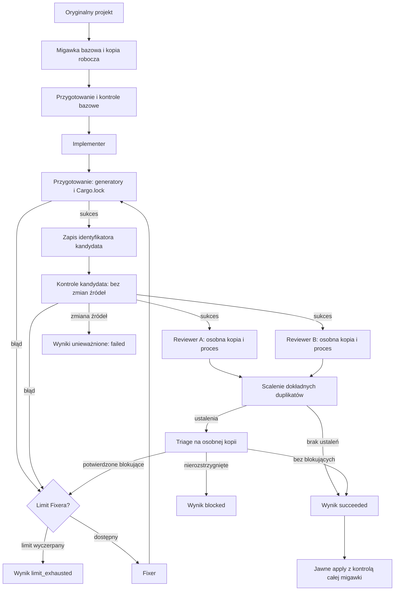

# Architektura workflow

`bb-rust-workflow` to lokalna maszyna stanów. Python steruje kolejnością etapów, procesami CLI, walidacją odpowiedzi, migawkami i zastosowaniem zmian. Agent nie może własną deklaracją pominąć kontroli ani zakończyć pętli. Celem jest audytowalny przebieg dla projektu Rust przy skończonych limitach czasu i wywołań.

## Przebieg

Recenzje są **niezależne co do procesu i kopii**: obaj recenzenci widzą tę samą zamrożoną migawkę, wymagania, wyniki kontroli i diff, ale nie wyniki drugiego recenzenta. Wywołania są sekwencyjne, co utrzymuje przewidywalny budżet. Po recenzjach program porównuje manifest źródła z migawką; zmiana w trakcie przeglądu kończy przebieg błędem. Triage musi rozstrzygnąć każde ustalenie dokładnie raz jako `confirmed`, `rejected`, `duplicate` lub `unresolved`, z uzasadnieniem. Dokładne duplikaty są scalane z zachowaniem pochodzenia; inne pozornie podobne uwagi rozstrzyga triage. Poziom kanonicznego ustalenia zachowuje najwyższą wagę w grupie duplikatów, aby scalanie nie usunęło blokady. Potwierdzone ustalenie zawiera też `duplicates` z pełnymi dowodami i pochodzeniem pozostałych uwag w grupie; Fixer otrzymuje je razem, aby naprawa nie zgubiła odmiennego scenariusza błędu. Ustalenia dotyczące usuniętych plików mogą wskazywać ścieżkę i linię z migawki bazowej. Kontekst Fixera wskazuje również `baseline_directory`, co pozwala odtworzyć dowody z usuniętych źródeł. `unresolved` blokuje sukces. Potwierdzone ustalenia o poziomach wymienionych w `blocking_severities` kierują do Fixera; domyślnie blokują `critical`, `high`, `medium`.

`max_cycles` oznacza liczbę **wywołań Fixera**, nie liczbę przeglądów. Brak zmian po naprawie albo powrót do wcześniej widzianej migawki kończy się `no_progress`. Po każdej naprawie wszystkie kontrole i obie recenzje są wykonywane ponownie. Każde wywołanie agenta liczy się do `max_agent_calls`; każdy proces ma własny timeout, a przed etapami sprawdzany jest budżet `max_seconds`. To limit kooperatywny: lokalne kopiowanie/hashowanie i sprzątanie procesów mogą opóźnić zakończenie poza budżet; operacje dyskowe nie są przerywane w połowie. Ponowienia dotyczą tylko ról odczytowych. Informacja o koszcie może być częściowa: raport przechowuje kwoty podane przez backend i liczbę wywołań bez kwoty, bez szacowania nieznanej sumy USD.

Polecenia `prepare` mogą zmieniać źródła i pliki wygenerowane; ich błędy kandydata kierują do ograniczonej pętli Fixera. Po przygotowaniu program zapisuje manifest kandydata. Przed i po każdej kontroli porównuje pliki z tym manifestem, a wyniki przechowują `snapshot_id`, `result_snapshot_id` i `source_unchanged`. Zmiana podczas kontroli kończy się `failed`, bez próby uznania wcześniejszych wyników za aktualne. Dopiero niezmieniony, sprawdzony kandydat trafia do recenzji.

Każda kopia — także bazowa, recenzenta i triage — ma własne `.git` i lokalny commit przechwyconej zawartości. Git nie wyszukuje repozytorium nadrzędnego. Kopia robocza zachowuje jako bazę aktualne źródła użytkownika, również zmiany niezatwierdzone i pliki nieśledzone. Kopie recenzentów zapisują jako własny commit otrzymanego kandydata; różnicę względem oryginału otrzymują w kontekście przeglądu i katalogu `baseline`. Inicjalizacja nie używa globalnych hooków, szablonów ani podpisywania. Procesy otrzymują środowisko bez zmiennych przekierowujących Git do innego repozytorium.

Przed kontrolami i pierwszym wywołaniem dostawcy program sprawdza istnienie zasobów wszystkich wybranych ról: umiejętności wewnątrz kopii projektu i plików MCP. Obejmuje to również warunkowe role triage/Fixer. Kontrola powtarza się przy wywołaniu roli, ponieważ wcześniejszy etap mógł usunąć wymagany plik. Nie sprawdza uwierzytelnienia ani dostępności modelu na koncie.

`BackendError.retryable` rozróżnia błędy dopuszczające ograniczone ponowienie od błędów konfiguracji adaptera, uruchomienia procesu, zmiany modelu i przekroczenia limitu wyjścia. Te ostatnie zatrzymują rolę bez ponowień. Pozostałe błędy dostawcy mogą być ponawiane tylko dla odczytowych ról, po ponownym sprawdzeniu niezmienności kopii i w ramach istniejących limitów.

## Odpowiedzialności modułów

| Moduł | Odpowiedzialność |
| --- | --- |
| `cli.py` | Polecenia `init`, `plan`, `doctor`, `verify`, `run`, `status`, `apply`; wejście konsolowe i raportowanie wyników. |
| `config.py`, `default.toml` | Parsowanie TOML, walidacja limitów/modeli/narzędzi i profili weryfikacji, heurystyka złożoności oraz wybór pięciu ról. |
| `engine.py` | Orkiestracja maszyny stanów: migawka, implementacja, kontrole, recenzje, triage, Fixer, limity, artefakty i raport. Pełny gate nadal poprzedza recenzje każdego kandydata. |
| `verification.py`, `verification_metadata.py` | Planowanie profili i wariantów, wykonanie kontroli, ograniczone próby wersji, skróty konfiguracji i raporty samodzielnego `verify`. |
| `diagnostics.py` | Czyste parsowanie pełnych strumieni, zachowawcze porównanie diagnostyki i skróty dowodów; bez uprawnień do zmiany wyniku wykonania. |
| `backends.py` | Jedna świeża sesja CLI dla roli, jawny model i format strukturalny, zapis surowego wyjścia, sprawdzenie zakończenia i zgłoszonego modelu. |
| `usage.py` | Normalizacja liczników Claude/Codex, cache bez podwójnego liczenia, sumy zmierzonych tokenów i jawne braki danych. |
| `process.py` | Uruchomienie argv bez powłoki, przechwycenie stdout/stderr, timeout i próba zatrzymania drzewa procesów na Linux/macOS/Windows. |
| `_windows_job.py` | Nadzorca Windows: przed uruchomieniem polecenia dołącza do Job Object z kończeniem członków przy zamknięciu; przekazuje kod zakończenia i błędy przez prywatny plik wyniku. |
| `protocol.py` | Wspólny schemat JSON odpowiedzi, walidacja ścieżek/linii ustaleń, deduplikacja oraz pełne rozstrzygnięcie triage. |
| `workspace.py` | Manifesty hashujące treść i prawa plików, zweryfikowane kopie, blokada projektu oraz `apply` z kontrolą konfliktu i próbą wycofania. |
| `prompts/*.md` | Instrukcje poszczególnych ról; nie są mechanizmem egzekwowania limitów ani kolejności. |

Samodzielne `verify` korzysta ze wspólnego wykonawcy kontroli, ale działa bezpośrednio na wskazanym repozytorium, pod jego blokadą. Nie wykonuje `prepare`, nie tworzy migawek ani workspace kandydata i nie wywołuje agentów. Zamraża manifest źródeł, porównuje go przed i po poleceniach oraz zapisuje pełne logi i raporty `report.json`/`report.md` w `.bb-workflow/verifications/<id>/`. Zmiany źródeł są wykrywane i powodują unieważnienie wyników; nie są automatycznie cofane. Nawet status `passed` ma `apply_eligible = false` i nie może autoryzować `apply`.

Claude dostaje minimalny zestaw narzędzi odpowiedni dla roli; zapis ma tylko implementer i Fixer. Opcjonalny `LSP` i `mcp_config` dotyczą Claude. Codex używa odczytowego lub zapisywalnego trybu pracy odpowiednio do roli, pomija odziedziczoną konfigurację użytkownika i w tym MVP nie przyjmuje konfiguracji MCP. Kontrole Rust (`cargo`) uruchamia sam orkiestrator z konfiguracji, a nie agent. Dostępność LSP nie jest warunkiem przebiegu: agent ma ujawnić fallback do źródeł, testów i `cargo`.

## Stan i artefakty

Jeden `run` tworzy `.bb-workflow/runs/<id>/` wewnątrz oryginalnego projektu:

- `workspace/`: kandydat edytowany przez implementera i Fixera;
- `baseline/`, `baseline_manifest.json`: kopia i manifest stanu początkowego;
- `checks/`: komendy, stdout i stderr każdej kontroli;
- `round-*-reviewer_a/`, `round-*-reviewer_b/`, `round-*-triage/`: odczytowe kopie danej rundy;
- `agents/`: prompty, wywołania, schematy, odpowiedzi oraz surowe logi agentów;
- `state.json`: bieżący stan, routing, limity, przebieg kontroli, recenzje, triage i koszty;
- `candidate_manifest.json`: manifest wyniku `succeeded`;
- `report.md`: krótkie podsumowanie dla człowieka;
- `apply-backup/` i `apply.json`: kopie i wynik jawnego zastosowania, jeśli je rozpoczęto.

Każda kontrola walidacyjna ma `diagnostics.json` z pełnym wynikiem parsera i porównaniem oraz `metadata.json` z hashami konfiguracji/środowiska i odsyłaczami do prób wersji. Próby w `checks/<faza>/metadata/` używają tego samego wykonawcy, środowiska migawki, limitu wyjścia i wspólnego budżetu czasu. Źródła są sprawdzane po każdej próbie; zmiana unieważnia kontrolę. Niepewne lub nieudane próby nie dają znanej tożsamości narzędzia. Cache nie przekracza granicy fazy. Konfiguracja obejmuje manifesty/lockfile, toolchain i Cargo/Clippy projektu, przodków, `CARGO_HOME`, `CLIPPY_CONF_DIR` oraz hashowane istotne zmienne środowiska. Niejednoznacznych nadpisań kompilatora, wrapperów, dołączanych konfiguracji i `--config` nie rozstrzygamy uniwersalnym resolverem: wersja pozostaje nieznana. Własne reguły `exclude` nadal ograniczają odczyt; skrót konfiguracji jest wtedy nieznany, gdyż wykluczenia mogą ukrywać istotne pliki. Własne nierozpoznane polecenia pomijają przechwytywanie konfiguracji i próby wersji.

Pełne porównanie fazy trafia do `checks/<faza>/diagnostics.json`, a stan i prompty zawierają ograniczony skrót z odsyłaczem. Rekordy bazowe i ich pliki pozostają niezmienione; wszystkie rundy kandydata porównują się z oryginalnym baseline. Agregacja działa także w kończeniu po błędzie, obejmując `unobserved_previous` dla niewykonanych kontroli. `persistent` nie zwalnia z zaliczenia gate. Nieznana konfiguracja/wersja/zakres uniemożliwia porównanie, a brak pełnego udanego wykonania uniemożliwia `resolved`. Wcześniejszy błąd testowy wymaga jawnego przejścia tego samego testu w kompletnym jednoznacznym zestawie. Samodzielny `verify` zachowuje te same artefakty i ograniczenia, lecz bez automatycznej bazy klasyfikuje znalezione problemy jako `unclassified`.

`state.json` jest zapisywany atomowo po ważnych etapach. `phase` opisuje bieżącą czynność, a `status` wynik całego przebiegu. Stany końcowe obejmują `succeeded`, `blocked`, `limit_exhausted`, `budget_exhausted`, `no_progress`, `failed` i `interrupted`. Po skutecznym `apply` stan przyjmuje `applied`. Katalog przerwanego lub nieudanego przebiegu pozostaje do inspekcji; automatycznego `resume` nie ma.

Kontekst agentów jest osobnym, skróconym widokiem dowodów: udane kontrole bez logów, błędy z ograniczonymi końcówkami i ścieżkami pełnych logów, diff z jawnym oznaczeniem pominięcia. Widok nie modyfikuje rekordów audytu. Limity `[context]` dotyczą fragmentów tekstu, nie całego kontekstu CLI ani budżetu tokenów. Schemat odpowiedzi trafia do natywnych flag CLI; `validate_response` nadal sprawdza wynik. Wybrane umiejętności są domyślnie wymaganymi odczytami plików, opcjonalnie wklejanymi przez `skill_mode = "inline"`.

`agents[].prompt_chars` i `prompt_bytes` opisują wysłany tekst, `usage` zachowuje dane dostawcy, a `token_usage` daje liczby znormalizowane. Dla Claude wejście obejmuje sumę niebuforowanego wejścia, odczytu cache i zapisu cache; dla Codex `input_tokens` już zawiera cache. `token_usage.by_backend` pokazuje zmierzone sumy wraz z `missing_calls` dla każdego licznika. Nieznanych wywołań nie uznaje się za darmowe. `status --summary` pomija szczegółowe dowody, pozostawiając postęp, pomiary i odsyłacz do raportu.

Poprawne pomiary zawarte w nieudanej odpowiedzi dostawcy są zachowywane w `invocation.json` i rekordzie agenta. Koszty są podsumowywane na podstawie rekordów przy każdym zapisie stanu; wywołanie przerwane lub zakończone wyjątkiem bez kwoty pozostaje nieznane. Odzyskane pomiary opisują raportowaną część użycia i nie gwarantują pełnego rozliczenia sesji zakończonej błędem.

## Granice bezpieczeństwa i zastosowanie zmian

`workspace.py` odrzuca niewykluczone dowiązania symboliczne i pliki specjalne. Domyślne katalogi wynikowe `target`, `build` i `dist` są pomijane tylko w korzeniu; `src/build` pozostaje źródłem. Wzorce `exclude` obsługują zakotwiczenie `/` i ponowne dołączenie `!`, ale `.git`, `.bb-workflow` i `.code-review-graph` są zawsze wyłączone. Kopia projektu izoluje wynik pracy od oryginalnych plików, lecz **nie izoluje hosta**: CLI agentów, skonfigurowane gates i MCP działają jako procesy użytkownika. Należy używać zaufanego repozytorium i konfiguracji. Artefakty mogą utrwalić sekrety ujawnione w źródłach, promptach lub wyjściach narzędzi.

`apply` działa wyłącznie dla `succeeded`. Pod blokadą projektu sprawdza identyfikatory manifestów, nienaruszony kandydat oraz zgodność **całego oryginalnego manifestu** z bazą, także dla plików niezwiązanych ze zmianą. Wykryty konflikt wstrzymuje kopiowanie. Zmiany katalog/plik są odrzucane przed modyfikacją. Przed zastosowaniem powstaje kopia plików zastępowanych; błąd po rozpoczęciu kopiowania uruchamia próbę rollbacku, a szczegóły zapisuje `apply.json`. Blokada koordynuje tylko ten program, nie zewnętrzne edytory. Gdy zostanie osierocona, należy upewnić się, że żaden przebieg już nie działa, zanim usunie się ją ręcznie.

Każda ścieżka jest ponownie sprawdzana przed modyfikacją. Dziennik w pamięci rejestruje tylko wykonane zastąpienia i usunięcia. Odzyskiwanie sprawdza oczekiwaną treść, prawa i tożsamość zapisanego pliku, zachowuje późniejsze zmiany oraz kontynuuje przywracanie pozostałych ścieżek. Konflikt daje niepełny rollback i ścieżkę `backup` w `apply.json`. Nie jest to transakcja systemu plików: między porównaniem a zapisem nadal możliwa jest zewnętrzna edycja, a po nagłym zakończeniu procesu odzyskiwanie pozostaje ręczne.
